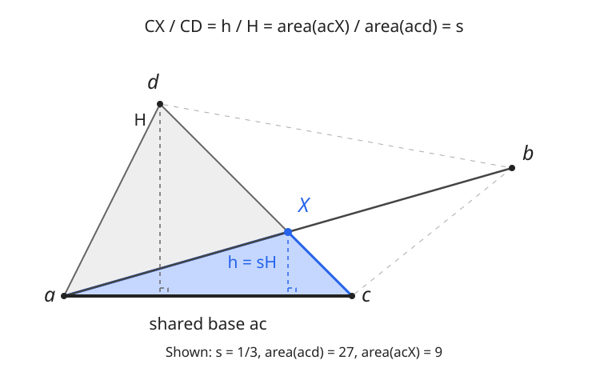

# Area without constructing the intersection point

`content/geometry/LineIntersectionArea.h` computes the **signed doubled area**
of triangle `a,c,X`, where `X` is the intersection of the nonparallel lines
`ab` and `cd`. It also applies to crossing segments; the helper does not test
whether the intersection lies inside them.

```cpp
using P = Point<ll>;
P a(0,0), b(14,4), c(9,0), d(3,6);
auto area2 = lineInterArea2(a,b,c,d); // long double: 18
auto precise = lineInterArea2<__float128>(a,b,c,d);
```



## Derivation

Write $X=c+s(d-c)$ and define

$$
U=(c-a)\times(b-a),\quad
V=(c-a)\times(d-c),\quad
D=(b-a)\times(d-c).
$$

Since $X$ lies on line $ab$,

$$
0=(X-a)\times(b-a)=U-sD,\qquad s=U/D.
$$

Triangles $acX$ and $acd$ have the same base $ac$. Their heights, and therefore
their areas, are in the ratio $s$. Since $V$ is twice the signed area of $acd$,

$$
2\,\operatorname{area}(acX)=sV=\frac{UV}{D}.
$$

The result is positive when the four vertices occur in counterclockwise order
`a,c,b,d`. For other arrangements it is signed. In the implementation,
`d.cross(a,c)` equals $V$: cyclic permutations preserve a triangle's signed area.

## Range and precision

Input coordinates must be integers in `[-1e9,1e9]`. The helper widens them to
`__int128` **before subtraction**, then evaluates the determinants and `U*V`
exactly. A determinant has magnitude at most `8e18`, and the product of two
such bounds is below the signed 128-bit limit. Parallel lines are excluded.

Only the final conversion and division use floating point. The default return
type is `long double`; use `lineInterArea2<__float128>` if later expressions
subtract large, nearly equal areas. This avoids forcing an entire rational
intersection coordinate, or an exact rational area, into `long long` storage.
The result is approximate, not an unbounded exact fraction.

Neither a wider scalar nor this helper can recover precision already lost by
rounding noninteger input coordinates. The coordinate bound is a precondition,
not a runtime range check. See [fraction arithmetic](fractions.md) for the
separate limits of `Point<Fraction>` constructions.

## Validation

The C++ stress test covers integral coordinate types, signs, transformations,
endpoint intersections, small nonzero determinants and the full coordinate
bound. Its Python companion constructs intersection coordinates with arbitrary-
precision rational arithmetic, then computes the triangle area independently.

```sh
python3 stress-tests/geometry/LineIntersectionArea.py
```
